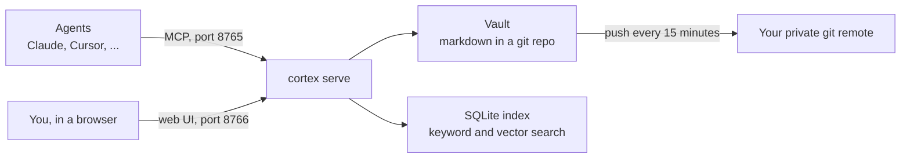

# Cortex

Shared memory for your AI agents. Cortex keeps what they know in a folder of markdown notes, tracks every change in git, and serves it all through one MCP server, so Claude, Cursor and any other MCP client work from the same rules, facts and history.

- **Plain files.** Notes are markdown you can read, edit and move without Cortex. The search index can always be rebuilt from them.
- **Local by default.** It runs on your machine and embeds notes locally. Voyage embeddings are optional.
- **Rules agents can't quietly break.** Writes are refused if they would duplicate a live note, overwrite a newer edit, touch `core/` or include something that looks like a credential.
- **Nothing is lost.** Every write is a git commit with the client's name on it. To forget a note, you move it to `.archive/`.

## How it works



At the start of a session, each agent receives `core/` and the memory index. It looks up anything else with the tools below.

| Tool | What it does |
|---|---|
| `search` | Find notes in `memory/` and `entities/`, and report matches in `docs/` and `logs/` |
| `read` | Read a note with its hash, links and backlinks |
| `list` | List a folder, newest first |
| `write` | Create a note, or replace one you just read |
| `update` | Change a note's frontmatter and record why in its History |
| `supersede` | Retire a note in favour of its replacement |
| `move` | Rename or archive a note and rewrite the links to it |
| `save_log` | Append to the daily, debrief or raw logs |

Read-only tokens can't see or call the write tools.

## Quick start

You need Python 3.12+, git and [uv](https://docs.astral.sh/uv/).

```bash
git clone https://github.com/navaneethkrishna30/cortex
uv tool install ./cortex

git clone https://github.com/navaneethkrishna30/cortex-vault-template ~/cortex-memory
git -C ~/cortex-memory remote remove origin

CORTEX_VAULT=~/cortex-memory cortex serve
```

The first run prints a setup token. Open `http://127.0.0.1:8766/ui`, enter it, set a password and enrol an authenticator app.

> [!WARNING]
> Cortex pushes the vault to every git remote it has. Keep your own remote private.

## Connect a client

The Access page in the UI shows your MCP address.

- **Claude Code and other token clients:** create a token on the Access page. It gives you a ready-made `claude mcp add` command.
- **OAuth clients:** add the MCP address to the client, then approve its code on the Access page. Claude and Cursor are allowed by default; add others with `redirect_allowlist`.

If a client ignores MCP server instructions, tell it to call `read("@context")`. The template's `AGENTS.md` and `CLAUDE.md` hold a line you can copy into each project.

## Reach it from other devices

| Port | Serves | Expose with |
|---|---|---|
| 8765 | `/mcp`, `/oauth/*` | Tailscale Funnel or Cloudflare Tunnel |
| 8766 | `/ui` | `tailscale serve` only, never a public tunnel |

Set `CORTEX_PUBLIC_URL` to the address clients use.

`deploy/cortex.service` is a hardened systemd unit. It expects a `cortex` user, an install in `/opt/cortex/.venv`, data under `/var/lib/cortex` and settings in `/etc/cortex.env`.

## Configuration

Where things live is set by the environment:

| Variable | Default |
|---|---|
| `CORTEX_VAULT` | `~/cortex-memory` |
| `CORTEX_AUTH_DB` | `~/.local/state/cortex/auth.sqlite` |
| `CORTEX_PUBLIC_URL` | `http://127.0.0.1:8765` |
| `CORTEX_MCP_PORT` | `8765` |
| `CORTEX_UI_PORT` | `8766` |
| `VOYAGE_API_KEY` | Unset; needed only for Voyage embeddings |

How the vault behaves is set in `.cortex/config.toml` inside it:

```toml
context_tokens = 2000       # budget for what agents receive at session start
duplicate_threshold = 0.96  # how similar a new note must be to count as a duplicate
quiet_seconds = 5.0         # wait after outside edits before committing them
push_minutes = 15           # how often to push to remotes
allowed_folders = ["core", "memory", "entities", "docs", "logs"]

[embedding]
provider = "fastembed"      # or "voyage"
model = "BAAI/bge-small-en-v1.5"
```

Run `cortex index --rebuild` after changing the embedding model.

## Commands

| Command | What it does |
|---|---|
| `cortex serve` | Run the MCP and UI listeners |
| `cortex index [--rebuild]` | Sync the index, or re-embed everything |
| `cortex doctor` | Show index size, repo size, remotes and broken links |
| `cortex eval FILE` | Score search against a TSV of questions and expected paths |
| `cortex auth reset` | Restart UI setup after losing a password or authenticator |

## Develop

```bash
uv run pytest
uv run cortex --vault "$(mktemp -d)" doctor
```

`tests/eval` holds a small search eval. Copy its vault somewhere temporary before running it. UI conventions are in [DESIGN.md](DESIGN.md).

## License

[MIT](LICENSE)
