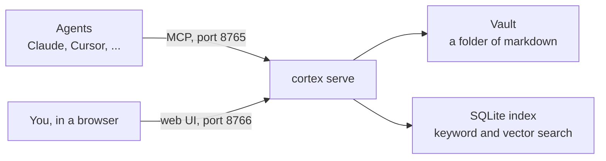

# Cortex

Shared memory for your AI agents. Cortex keeps what they know in a folder of markdown notes, logs who changed what, and serves it all through one MCP server, so Claude, Cursor and any other MCP client work from the same rules, facts and history.

- **Plain files.** Notes are markdown you can read, edit and move without Cortex. The search index can always be rebuilt from them.
- **Light.** It runs on your machine in about 60 MB; Voyage makes the embeddings. If Voyage is down, nothing fails: search falls back to keywords and vectors are filled in later. Local embeddings are the `local` extra.
- **Rules agents can't quietly break.** Writes are refused if they would duplicate a live note, overwrite a newer edit, touch `core/` or include something that looks like a credential.
- **Nothing is deleted.** Every change is a line in `.cortex/changes.jsonl` with the client's name on it. To forget a note, you move it to `.archive/`.

## How it works



At the start of a session, each agent receives `core/` and the memory index. It looks up anything else with the tools below.

| Tool | What it does |
|---|---|
| `search` | Find notes in `memory/` and `entities/`, and report matches in `docs/` and `logs/` |
| `read` | Read a note with its hash, links and backlinks |
| `list` | List a folder, newest first |
| `write` | Create a note, or replace one you just read |
| `update` | Change a note's frontmatter and record why in its History |
| `supersede` | Retire a note in favour of its replacement |
| `move` | Rename or archive a note and rewrite the links to it |
| `save_log` | Append to the daily, debrief or raw logs |

Read-only tokens can't see or call the write tools.

## Quick start

You need Python 3.12+ and [uv](https://docs.astral.sh/uv/).

```bash
git clone https://github.com/navaneethkrishna30/cortex
uv tool install ./cortex

git clone --depth 1 https://github.com/navaneethkrishna30/cortex-vault-template ~/cortex-memory
rm -rf ~/cortex-memory/.git   # the vault is plain files, not a repo

CORTEX_VAULT=~/cortex-memory cortex serve
```

The first run prints a setup token. Open `http://127.0.0.1:8766/ui`, enter it, set a password and enrol an authenticator app.

> [!WARNING]
> Cortex keeps no old versions of notes. Backups are your job: copy the vault folder and `auth.sqlite` on a schedule. `.cortex/index.sqlite*` and the model cache rebuild on their own, so you can leave them out. A `.git` left in the vault by an older Cortex is ignored.

## Connect a client

The Access page in the UI shows your MCP address.

- **Claude Code and other token clients:** create a token on the Access page. It gives you a ready-made `claude mcp add` command.
- **OAuth clients:** add the MCP address to the client, then approve its code on the Access page. Claude and Cursor are allowed by default; add others with `redirect_allowlist`.

If a client ignores MCP server instructions, tell it to call `read("@context")`. The template's `AGENTS.md` and `CLAUDE.md` hold a line you can copy into each project.

## Reach it from other devices

| Port | Serves | Expose with |
|---|---|---|
| 8765 | `/mcp`, `/oauth/*` | Tailscale Funnel or Cloudflare Tunnel |
| 8766 | `/ui` | `tailscale serve` only, never a public tunnel |

Set `CORTEX_PUBLIC_URL` to the address clients use.

To run it as a container, build the `Dockerfile` and mount one directory at `/data`. The vault goes in `/data/vault`, and the auth database sits beside it. Run the container as the user that owns that directory:

```sh
docker build -t cortex .
docker run -d --restart always --user 1000:1000 -v /srv/cortex:/data \
  -p 127.0.0.1:8765:8765 -p 127.0.0.1:8766:8766 \
  -e CORTEX_PUBLIC_URL=https://your-host --env-file voyage.env cortex
```

The image's healthcheck calls `GET /healthz` on the UI port. It answers only after the index responds to a query, and the public port does not serve it. Its reply also names the embedder and counts `pending` notes, the ones still waiting for vectors; a count that never falls means a bad or missing key.

`deploy/cortex.service` is a hardened systemd unit for running without a container. It expects a `cortex` user, an install in `/opt/cortex/.venv`, data under `/var/lib/cortex` and settings in `/etc/cortex.env`.

## Configuration

Where things live is set by the environment:

| Variable | Default |
|---|---|
| `CORTEX_VAULT` | `~/cortex-memory` |
| `CORTEX_AUTH_DB` | `~/.local/state/cortex/auth.sqlite` |
| `CORTEX_PUBLIC_URL` | `http://127.0.0.1:8765` |
| `CORTEX_MCP_PORT` | `8765` |
| `CORTEX_UI_PORT` | `8766` |
| `CORTEX_HOST` | `127.0.0.1`; the image sets `0.0.0.0` |
| `VOYAGE_API_KEY` | Unset; needed for Voyage embeddings and reranking |
| `CORTEX_EMBEDDING_PROVIDER`, `_MODEL`, `_DIMENSIONS` | Override `[embedding]` below |
| `CORTEX_RERANK_PROVIDER`, `CORTEX_RERANK_MODEL` | Override `rerank_provider` and `rerank_model` below |

How the vault behaves is set in `.cortex/config.toml` inside it:

```toml
context_tokens = 2000       # budget for what agents receive at session start
duplicate_threshold = 0.96  # how similar a new note must be to count as a duplicate
quiet_seconds = 5.0         # wait after outside edits before reindexing and logging them
memory_body_limit = 300     # longest memory line, in characters
entity_body_limit = 1200    # longest card body, History left out
allowed_folders = ["core", "memory", "entities", "docs", "logs"]
rerank_provider = "none"    # or "voyage", which needs VOYAGE_API_KEY
rerank_model = "rerank-3"
rerank_timeout_s = 3        # slower than this, search keeps its own order
rerank_candidates = 30      # how many top notes the reranker reorders

[embedding]
provider = "voyage"         # or "fastembed" with the local extra, model "BAAI/bge-small-en-v1.5"
model = "voyage-4-lite"
dimensions = 1024           # Voyage only: 256, 512, 1024 or 2048
```

Reranking is off by default. When it is on, agent searches send the query and one snippet per candidate note to Voyage, which reorders them. A timeout, an error or a missing key never fails a search: results keep their usual order and say `reranked: false`. The web UI's search and `exact=true` are never reranked.

A changed embedding model re-embeds every note on the next start, and a new Cortex version that changes what the index holds rebuilds it by itself. `cortex index --rebuild` does the same by hand.

## Commands

| Command | What it does |
|---|---|
| `cortex serve` | Run the MCP and UI listeners |
| `cortex index [--rebuild]` | Sync the index, or re-embed everything |
| `cortex doctor` | Show index size, vault size, change-log entries and broken links |
| `cortex eval FILE [--rerank on\|off] [--json]` | Score search against a TSV of questions and expected paths: hit@1, hit@8, MRR, latency and misses |
| `cortex auth reset` | Restart UI setup after losing a password or authenticator |

## Develop

```bash
uv sync --group dev
make check      # ruff, pyright, pytest
uv run cortex --vault "$(mktemp -d)" doctor
```

`tests/eval` holds a small search eval. Copy its vault somewhere temporary before running it. Each line of a question file is `question<TAB>expected path`; write `path1|path2` when either note answers it. Run it with `--rerank off` and `--rerank on` to see whether reranking helps. UI conventions are in [DESIGN.md](DESIGN.md).

## License

[MIT](LICENSE)
